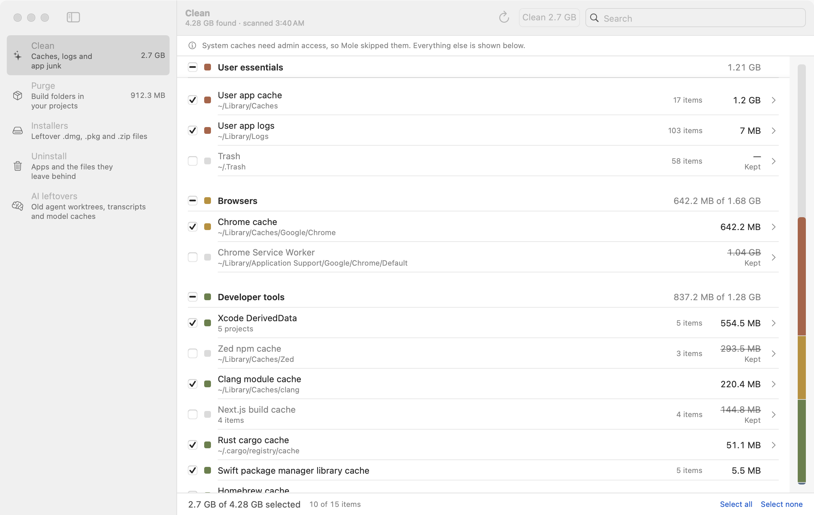

# Burrow

A small native macOS app that gives a review-and-pick window to the Mole cleaner CLI.



Not affiliated with Mole or its author. Mole for Mac (mole.fit) is the official paid app.

## Requirements

- macOS 14 or later, Apple Silicon
- Mole installed with Homebrew: `brew install mole`
- Tested with Mole 1.59.x

## Build

```
swift build
scripts/build-app.sh
```

`scripts/build-app.sh` writes `build/Burrow.app`, ad-hoc signed. The app is not notarized, so the first launch may need right-click, then Open.

## Screens

- **Clean**: caches, logs, browser, developer and app junk. Caches and logs are deleted. Trash is emptied permanently only if you tick it; it is off by default.
- **Purge**: project build folders such as `node_modules`, `.next`, `dist` and `.venv`. They are deleted.
- **Installers**: leftover `.dmg`, `.pkg` and `.zip` files. They are deleted.
- **Uninstall**: apps and their leftovers, moved to the Trash by Mole. Homebrew casks are not offered, because Mole removes them permanently with `brew --zap`.
- **AI leftovers**: old agent git worktrees, Claude Code and Codex transcripts, and model caches. Worktrees and files are moved to the Trash, never deleted. Worktrees with uncommitted or unpushed work, or in use, are skipped. Items under 30 days old are never offered. Worktrees, transcripts and models are never ticked by default.

## How safety works

- Mole does every delete except AI leftovers. Burrow has no cleaning engine of its own.
- Every preview runs Mole in dry-run mode first. You untick what you do not want, then confirm.
- Unticked Clean rows are added to Mole's whitelist for that run only. The whitelist is restored byte-for-byte afterwards.
- Burrow re-previews before running and stops if anything unreviewed appears.
- Menu selections (Purge, Installers) are checked against Mole's own count before Enter is sent.
- Burrow never types a password. If a password prompt appears, it stops.

## Known limits

- Real removal runs were never exercised in development. Start with a small selection.
- Mole output parsing is tied to Mole 1.59.x. Other versions may break parsing.
- Cache items that need sudo are skipped.

## Privacy

No telemetry, no network.

## License

MIT. See [LICENSE](LICENSE).
